# NICE-DEV
### Backend Engineering · Software Architecture · DevOps

Reliable APIs, backend systems and developer tools — with a growing focus on **Go, Rust and cloud infrastructure**.

[Portfolio](https://www.sawadogoazael.com/) · [GitHub](https://github.com/NICE-DEV226)

---

## About

I'm **Azaël Sawadogo**, a software developer focused on backend engineering. I care about how systems behave under real constraints: concurrency, failure, security, performance, maintainability. I build tools that are useful to other developers, and I contribute to open source.

## Technical stack

  
  
  
  
  
  
  
  
  
  
  
  
  
  

Working stack and areas of focus, not equal proficiency in every technology. Backend-first.

## Projects

### [Dun](https://github.com/NICE-DEV226/Dun)
**Go · HTTP proxy · WebAssembly**

A small Go proxy that routes requests through capability-scoped WebAssembly extensions, with explicit limits, lifecycle controls, health endpoints and Prometheus-compatible metrics.

### [NICE-API'HUB](https://github.com/NICE-DEV226/nice-api-hub)
**Go · Fastify · PostgreSQL · Redis · Docker**

A media-provider API with authentication, rate limiting, caching, interchangeable providers and automatic failover; a separate Go CLI covers the same surface.

### [ACIES](https://github.com/NICE-DEV226/ACIES)
**Python · Go · Computer vision**

An adaptive perception controller that decides when, and how much, computation to spend on an input — cost-aware decisions on top of existing vision models.

### [Kelvra](https://github.com/NICE-DEV226/kelvra)
**Policy language · AI agent security**

Explicit information-flow policies and audit records for LLM agent pipelines: declare what an agent may know, keep a signed record of what it did. Spec stage.

## How I work

- **Design:** clear boundaries, explicit responsibilities, designs that can evolve.
- **Reliability & security:** retries, duplicate events and partial failures accounted for; input validated, permissions explicit.
- **Operations:** systems observable, testable, deployed through repeatable workflows.
- **Simplicity:** solve the actual problem before adding infrastructure.

Currently going deeper into Rust and Go for systems programming, distributed-systems trade-offs, and testing race conditions, idempotency and failure handling.

<!-- cool-readme:start -->
## GitHub activity

<picture>
  <source media="(prefers-color-scheme: dark)" srcset="stats/summary-dark.svg">
  
</picture>
<picture>
  <source media="(prefers-color-scheme: dark)" srcset="stats/languages-dark.svg">
  
</picture>

<picture>
  <source media="(prefers-color-scheme: dark)" srcset="stats/contributions-dark.svg">
  
</picture>
<picture>
  <source media="(prefers-color-scheme: dark)" srcset="stats/weekly-dark.svg">
  
</picture>

<!-- cool-readme:end -->
